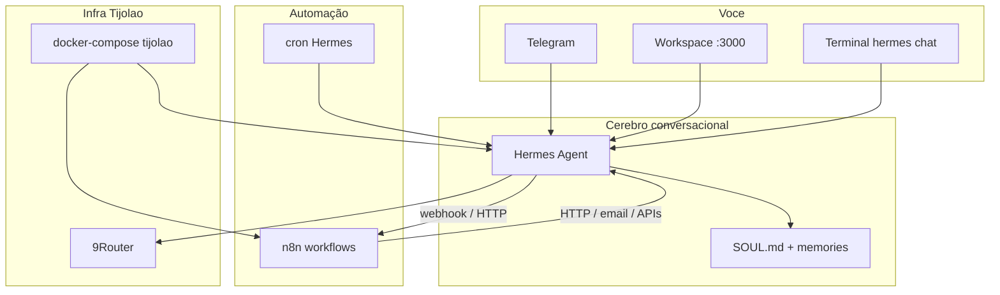

# ULTRON — assistente pessoal (versão que deu certo)

**Objetivo do projeto:** um “Jarvis estável” para o Dr. Nícholas — médico intensivista, programador iniciante — não um robô rebelde. Proativo onde ajuda, **obediente** onde importa, memória e rotina, Telegram + web + terminal.

**Meta ativa (goal):** integrar Hermes Agent, n8n, Docker Compose e peças já existentes no Tijolão até operação estável, com papéis claros e provas de saúde.

**Restrições explícitas do Dr. (29-out-2026):**

- Não endurecer aprovações de terminal (`approvals` permanece como configurado).
- MCP filesystem permanece em `/home/dr`.
- Não usar Git commit/push automático em `~/.hermes` como estratégia de backup.

---

## 1. O que “ULTRON deu certo” significa aqui

| Filme (Ultron ruim) | ULTRON deste projeto |
|---------------------|----------------------|
| Objetivos próprios | Objetivos **seus**, escritos em `SOUL.md` + memória |
| Age sozinho em massa | Age sozinho **só** no escopo que você liberou (cron, n8n, kanban) |
| Sem travas | Travas **suas** (Telegram allowlist, Docker, Honcho, o que você escolher) |
| Um corpo só | **Vários módulos**, um “cérebro” conversacional |

**Tradução:** ULTRON = **orquestração** — Hermes pensa e fala; n8n dispara rotinas; Docker segura o ambiente; workspace é a “sala de comando”.

---

## 2. Inventário atual (evidência medida)

| Peça | Função | Onde | Estado |
|------|--------|------|--------|
| **Hermes Agent** | Conversa, tools, memória, Telegram, gateway API | `~/.hermes`, container `hermes-agent` | Gateway + Telegram; API `127.0.0.1:8642`; dashboard `9119` |
| **hermes-workspace** | UI web (chat, arquivos, memória, swarm UI) | container `hermes-workspace`, `:3000` | Healthy; Tailscale serve `:10000` → 3000 |
| **Stack Docker** | Sobe agent + workspace | `~/.config/hermes-stack/docker-compose.tijolao.yml` | `network_mode: host`; bind `~/.hermes`, `~/src` |
| **9Router / Poolside** | Modelos e fallback | loopback `:20128`, Poolside cloud | No `config.yaml` |
| **Kanban + Honcho** | Tarefas e memória social | plugins + `kanban.db` | Ativos no perfil default |
| **Cron Hermes** | Agendamentos dentro do agente | `~/.hermes/cron/` | Existe |
| **n8n** | Automações visuais (fluxos) | container `ultron-n8n`, `:5678` | No compose Tijolão; ver `ULTRON-N8N.md` |
| **Swarm / especialistas** | Workers tmux + perfis | `swarm.yaml` | **Workers vazios** (`workers: []`); `AGENTS.md` descreve frota antiga — doc a realinhar na Fase 1 |

Referência operacional: [`kanban/attachments/t_26f5109e/hermes-workspace-relatorio.md`](../kanban/attachments/t_26f5109e/hermes-workspace-relatorio.md), skill `hermes-workspace`.

---

## 3. Arquitetura alvo (camadas)



### Papéis fixos (não misturar)

| Sistema | Faz | Não faz |
|---------|-----|---------|
| **Hermes** | Raciocínio, linguagem, tools, memória longa, Telegram | Substituir ERP hospitalar; prescrever sem você |
| **n8n** | Rotinas repetíveis (email, planilha, webhook, lembrete) | “Pensar” caso clínico complexo sozinho |
| **Workspace** | Painel único no browser / PWA iPhone | Rodar o gateway (só consome API) |
| **Docker Compose** | Mesma máquina, mesmas portas, mesmo `.hermes` | Magia de sync entre PCs |

---

## 4. Casos de uso ULTRON (médico + dev amador)

1. **Plantão / UTI:** triagem de pendências (kanban), lembretes cron, busca em vault Obsidian (`vaults/celebro`), evidência com skill/revisor quando pedido.
2. **Código / infra:** `chefe`-style via Hermes + terminal Docker; workspace em `~/src`; fiscal/revisor quando você reativar perfis.
3. **Rotina pessoal:** n8n (fase 2+) — ex.: digest diário, backup de lista, integração Google/Airtable **sem** reimplementar no Hermes.
4. **Um rosto:** Telegram `@SUBCOMANDANTE_BOT` + workspace Tailscale — mesma memória `~/.hermes`.

---

## 5. Roadmap por fases (com prova)

### Fase 0 — Alinhamento (este documento)

- [x] Blueprint ULTRON escrito
- [ ] Você valida prioridade: **n8n primeiro** vs **reativar swarm/chefe-residente** vs **fluxos clínicos**

### Fase 1 — “Um cérebro, uma sala de comando” (já ~80%)

**Entregável:** checklist verde repetível.

```bash
curl -fsS http://127.0.0.1:8642/health
curl -fsS http://127.0.0.1:9119/api/status
curl -fsS -o /dev/null -w '%{http_code}' http://127.0.0.1:3000/
# Telegram: mensagem teste + resposta
```

**Ajustes doc:** realinhar `AGENTS.md` ↔ `swarm.yaml` (workers vazios).

### Fase 2 — n8n no stack Tijolão

**Entregável:** serviço `n8n` no compose (loopback, volume de dados, env no cofre).

- [x] Serviço `n8n` em [`docker-compose.tijolao.yml`](file:///home/dr/.config/hermes-stack/docker-compose.tijolao.yml)
- [x] Doc [`ULTRON-N8N.md`](file:///home/dr/.config/hermes-stack/ULTRON-N8N.md) + workflows importáveis
- [x] `tijolao` atualizado (status / logs / health n8n)
- [x] `N8N_ENCRYPTION_KEY` via `~/.local/state/n8n/stack.env` (tijolao) + container **healthy**
- [x] Workflow **ULTRON — teste webhook** importado/ativo; `POST /webhook/ultron-test` → HTTP 200
- [x] Workflow hook **ultron-hermes** importado/ativo (aguarda `hooks.outbound` no Hermes, opcional)
- [x] Script [`scripts/ultron-n8n-bootstrap.sh`](file:///home/dr/.config/hermes-stack/scripts/ultron-n8n-bootstrap.sh)

**Prova:**

```bash
curl -fsS http://127.0.0.1:5678/healthz
curl -fsS -X POST http://127.0.0.1:5678/webhook/ultron-test -H 'Content-Type: application/json' -d '{"ping":1}'
```

**Opcional:** MCP instance-level n8n (Cursor) **separado** — útil no IDE; ULTRON no servidor usa n8n **self-hosted**.

### Fase 3 — Ponte Hermes ↔ n8n

- [x] `hooks.outbound` em [`config.yaml`](file:///home/dr/.hermes/config.yaml) → `http://127.0.0.1:5678/webhook/ultron-hermes` (`on_session_end`)
- [x] Workflow `ultron-hermes-hook.json` ativo; POST simulado → HTTP 200
- [x] Script [`ultron-health.sh`](file:///home/dr/.config/hermes-stack/scripts/ultron-health.sh) — prova única da stack

### Fase 4 — Identidade ULTRON

- [x] [`SOUL.md`](file:///home/dr/.hermes/SOUL.md) §9 ULTRON + [`memories/`](file:///home/dr/.hermes/memories/) USER/MEMORY

### Operação estável

Rodar após restart ou update:

```bash
~/.config/hermes-stack/scripts/ultron-health.sh
tijolao status
```

Telegram pode levar ~30s após restart do `hermes-agent` até `gateway_state` = `connected`.

### Fase 5 — Especialistas (opcional, pós-estável)

Recriar workers em `swarm.yaml` + `~/.hermes/profiles/<id>/` conforme `AGENTS.md`, **só** se Swarm tmux ou wrappers forem prioridade.

---

## 6. Próximo passo imediato recomendado

**Decisão única:** Fase 2 (subir n8n no compose) **ou** Fase 1 (fechar doc swarm + um fluxo kanban/cron “ULTRON”).

Quando você disser qual, implementamos no repo `~/.config/hermes-stack/` (compose + README curto), **sem** tocar nas três restrições acima.

---

## 7. Glossário rápido

| Termo | Significado |
|-------|-------------|
| **Gateway** | Porta HTTP do Hermes que recebe API e sessões (`8642`) |
| **Compose** | Arquivo que diz quais containers sobem juntos |
| **n8n** | Automatizador visual (fluxos tipo “se isso, então aquilo”) |
| **MCP** | Tomada padrão de ferramentas extras no agente |
| **Workspace** | Site local que fala com o Hermes |

---

*Criado: 29-out-2026 — goal ULTRON.*
